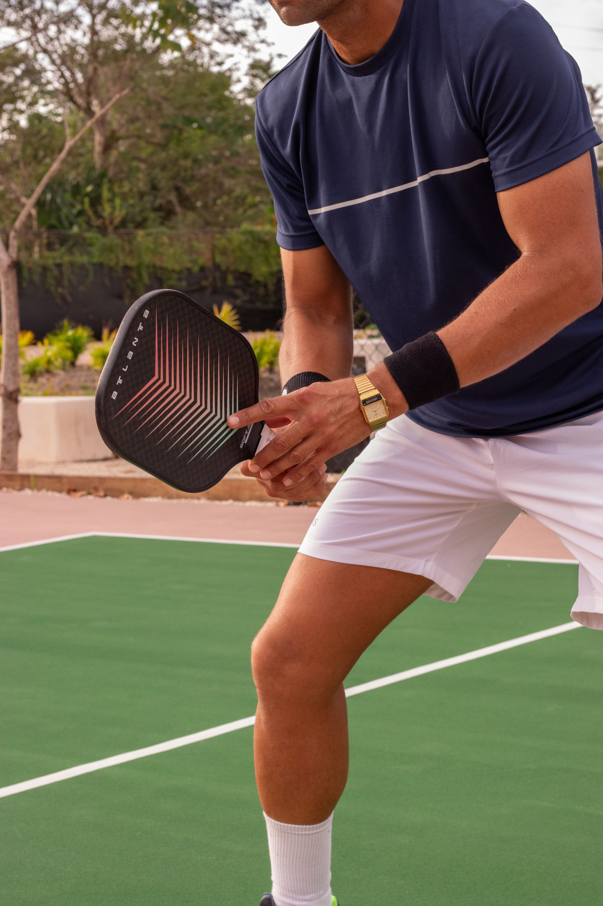
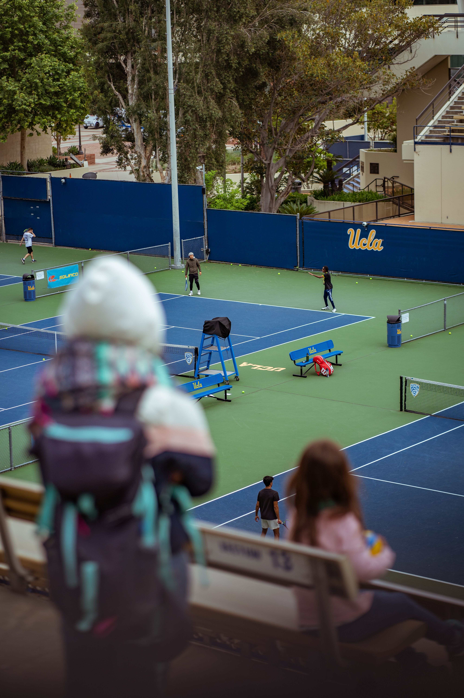

# PivotPB personas

## Background: how the queue works today

Players at a pickleball court queue by stacking their paddles in a pile beside the court. The deeper a paddle sits in the stack, the earlier its owner arrived, so the paddle at the bottom belongs to the next group to play. Players call this stacking (observation). PivotPB replaces the physical stack with a digital queue for each court.

## Jerich, the player

> "Someone slid their paddle under mine and then said they were first." 

| | |
| --- | --- |
| **Photo or sketch** |  |
| **Age, role and background** | 20, 3rd year IT student, plays pickleball with two or three friends after class, has a ride home he needs to catch (assumption) |
| **Goals** | Hold his place in line for a court without standing guard over his paddle. Know how many groups are ahead of him, since a pile of paddles hides the real order. Take a break or grab water and still keep his turn. |
| **Frustrations** | The stack shows order only to people who dig through it, so nobody can see how long the wait is. Paddles get knocked over, shuffled or slipped underneath, which causes arguments about who was first. Leaving the court means risking his spot, because the stack only works if his paddle stays there. (observation, assumption) |
| **Devices and context** | Phone in one hand, often outdoors in bright light, on mobile data that can be slow. Paddle or water bottle in the other hand. (assumption) |
| **Tech comfort** | High. He uses apps all day, but he will not read instructions while waiting. |
| **Accessibility needs** | Large text and high contrast for sunlight glare. Big tap targets for sweaty or busy hands. Must not depend on sound, since the courts are loud. |

### Scenario

Jericho arrives at the courts at 4:30 with two friends and sees all three courts in use. Normally he would lay his paddle on a stack and hope nobody disturbs it. Instead he opens PivotPB on his phone, joins Court 2 as a group of four, and gets ticket number 3. He sees two groups ahead, so he sits on the bench to rest. Ten minutes later his phone shows that he is next, then called, and he walks to Court 2 with his friends. If his plans change, he taps Leave the queue so he does not hold up the line.

### Top tasks in the app

| Task | Screen | Requirement ID |
| --- | --- | --- |
| Join the queue for a court, like adding a paddle to the stack | Join | FR-01 |
| Check how many groups are ahead | My place | FR-02 |
| Leave the queue | My place | FR-03 |

### What this means for my interface

1. Because a pile of paddles hides the real order, his court, ticket number and position must be the largest and highest contrast items on My place, so the order is always visible.
2. Because he checks his phone with one hand while outdoors in glare, text must be large with strong contrast, and the status must show in words as well as color.
3. Because arguments over who was first come from a stack anyone can rearrange, tickets must be numbered in the order people join, and a player must not be able to change their own place.
4. Because he wants to rest without losing his turn, the page must update by itself and clearly show when he is called, with a Leave the queue button when plans change.

## Lara, the organizer

> "When three groups show up at once, I cannot tell whose paddle went down first."

| | |
| --- | --- |
| **Photo or sketch** |  |
| **Age, role and background** | 22, 4th year student who volunteers as organizer for open play on weekday evenings, manages three courts at once |
| **Goals** | See every court's line at a glance instead of checking each stack by hand. Call the next group the moment a court frees up. Keep things fair so nobody complains about a skipped turn. |
| **Frustrations** | Paddle stacks are easy to shuffle by accident, so she ends up settling disputes about order. She cannot tell whose paddle belongs to which player or group. Groups leave their paddles in the stack and wander off, so she waits for people who are not there. (observation, assumption) |
| **Devices and context** | A phone or shared laptop at a table beside the courts, with constant interruptions from players asking questions. (assumption) |
| **Tech comfort** | Medium. She is comfortable with apps but wants very few steps per action. |
| **Accessibility needs** | Large buttons for quick taps while standing. Clear labels so she never taps the wrong ticket. Readable in daylight. |

### Scenario

Lara sets up at the side of the courts at 4 pm and opens the PivotPB staff dashboard on her phone. Court 1 has four groups waiting, Court 2 has one, and Court 3 is empty. She no longer has to look at three piles of paddles. When a game ends on Court 1, she taps Call next, and the first waiting group is called. If nobody comes after a few minutes, she marks them as a no show and calls the next group. When the group reaches the court, she marks the ticket as served.

### Top tasks in the app

| Task | Screen | Requirement ID |
| --- | --- | --- |
| See the waiting list in order for each court, like a readable stack | Staff dashboard | FR-04 |
| Call, serve, or mark a group as no show | Staff dashboard | FR-05 |
| See how many groups are waiting per court (★) | Staff dashboard | FR-06 |

### What this means for my interface

1. Because the physical stack hides the order, the dashboard must list each court's queue in clear order, with the next group at the top.
2. Because Lara manages three courts at once, the dashboard must separate courts clearly and let her filter to one court.
3. Because she is interrupted constantly and often standing, Call next must be the biggest and easiest button to reach, and every action must be one tap.
4. Because groups sometimes leave their paddles and walk away, she must be able to mark a no show quickly so the line keeps moving.