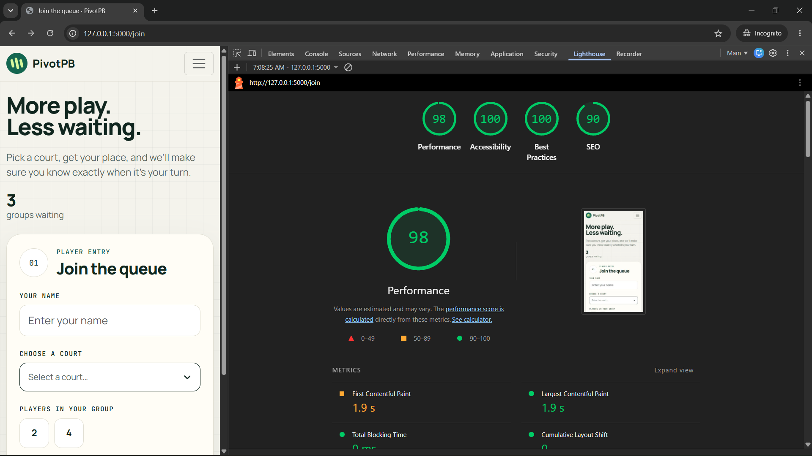
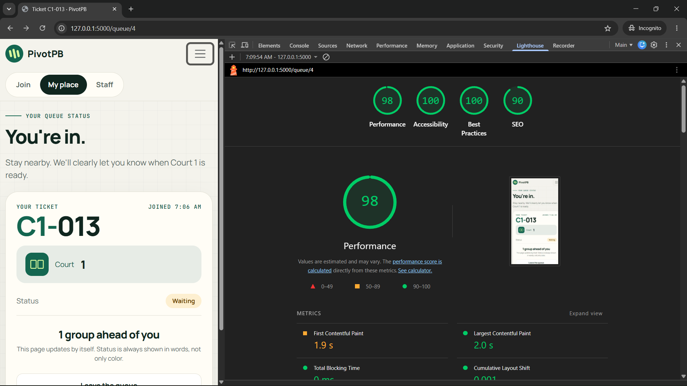
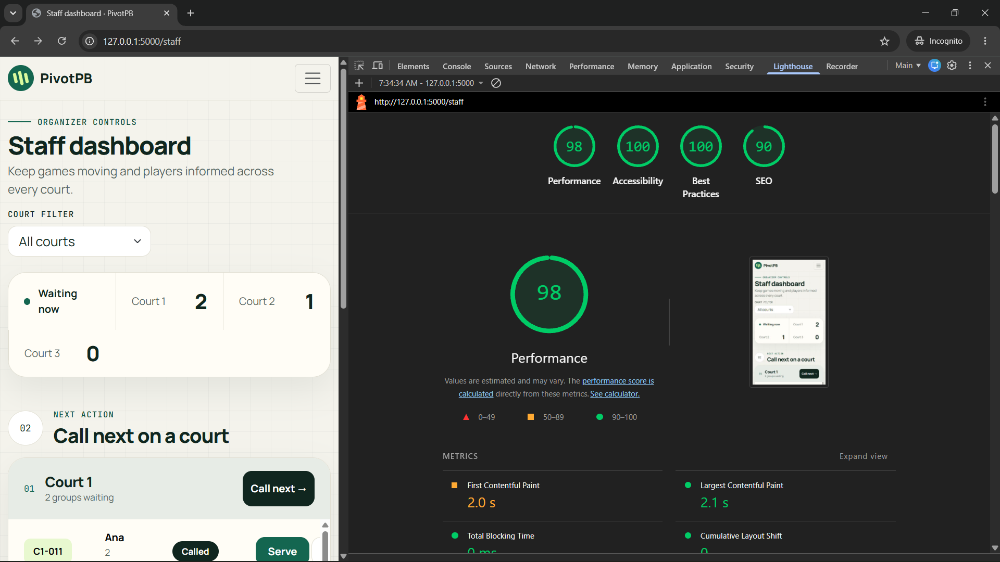

# Accessibility check

## Lighthouse (Mobile, Accessibility)

| Screen | Before | After | Main issues fixed |
| --- | --- | --- | --- |
| Join | (screenshots/lighthouse-join-1.png) | (screenshots/lighthouse-join-1.png) | No Issue |
| My place | (screenshots/lighthouse-myplace-1.png) | (screenshots/lighthouse-myplace-1.png) | No Issue |
| Staff dashboard | (screenshots/lighthouse-staff-1.png) | (screenshots/lighthouse-staff-1.png) | No Issue |

Anything still below 90 and why: None

## Keyboard only test

**Join from the home page:** I used only Tab, Enter, the arrow keys and Space. The skip link appeared on the first Tab: ✅. Focus was visible at every step: ✅.
**Staff filter, call and serve:** I can reach each buttons using tab and trigger them using enter.
**What failed and how I fixed it:** Nothing failed

## Manual checklist

| Check | Join | My place | Staff |
| --- | --- | --- | --- |
| Every input has a visible label | ✅ Name, court and group size each have a visible label | N/A, no inputs on this screen | ✅ Court filter has a visible label |
| Error messages say what to do, in text | ✅ "Enter your name.", "Choose a court.", "Choose 2 or 4 players." | N/A, no form to fill in | ✅ Messages name the ticket and what happened |
| Status is shown in words, not only color | N/A, shows waiting counts in words only | ✅ Status pill says Waiting, Called, Served, No show or Left | ✅ Status pills carry text |
| Readable at 375 px with no sideways page scroll | ✅ | ✅ | ✅ |
| Buttons at least about 44 × 44 px | ✅ | ✅ | ✅ |
| One h1 and headings in order | ✅ h1 then h2 | ✅ one h1 | ✅ h1, h2, then h3 per court |
| html lang is set | ✅ | ✅ | ✅ |

**Fixes made from the checklist:** no fixes needed