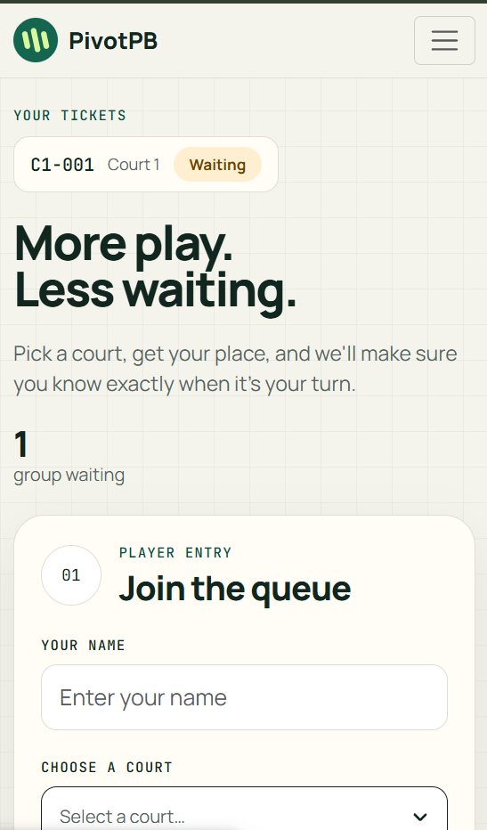
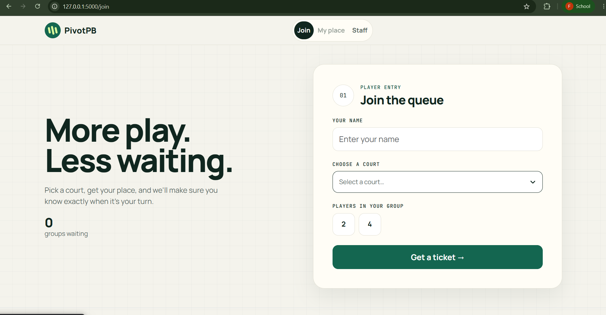
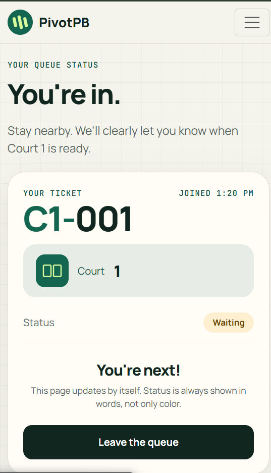
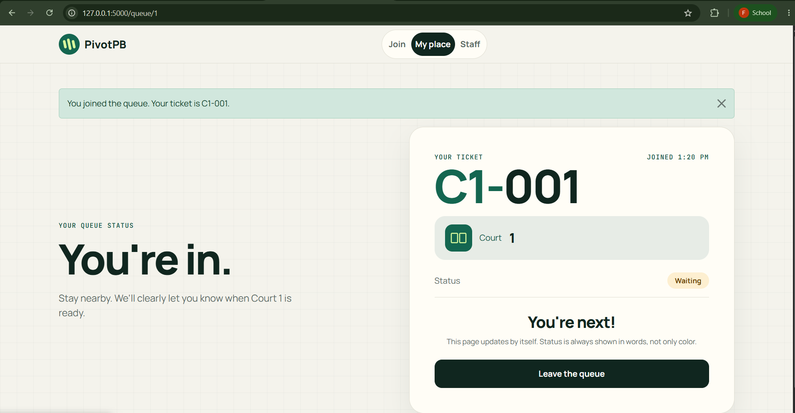
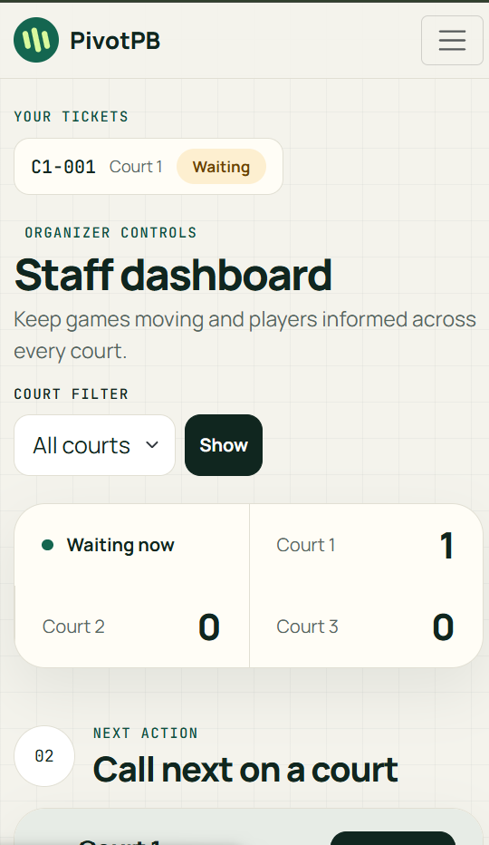
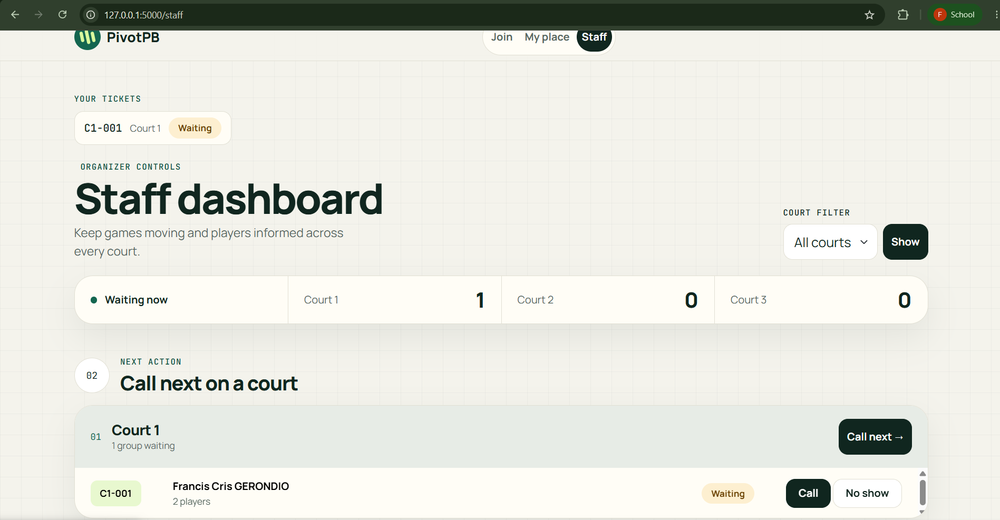

## Title details

* App name: PivotPB
* Setting: pickleball open play on campus courts, where players queue for a court and organizers call the next group
* Full name: Francis Cris P. Gerondio
* Student ID: 2024-0861
* Date: October 25, 2026

## Personas

We did not do the week 1 research, wich is why I can not include interviews with real players or organizers, so both personas are built from how open play and paddle stacking work on the courts. Their quotes and details are labeled as assumptions in the personas file. The usability test is my first contact with a real user. Full personas: [docs/week3/personas.md](personas.md)

**Jerich, the player.** Quote (assumed): "Someone slid their paddle under mine and then said they were first."
Top tasks: join the queue for a court (FR-01), check how many groups are ahead (FR-02), leave the queue (FR-03).

**Lara, the organizer.** Quote (assumed): "When three groups show up at once, I cannot tell whose paddle went down first."
Top tasks: see the waiting list in order for each court (FR-04), call, serve or mark a no show (FR-05), see how many groups are waiting per court (FR-06).

## Screens

Jerich joins the queue on his phone. Covers FR-01.

Jerich joins the queue on a laptop. Covers FR-01.

Jerich checks his ticket, status and position on his phone. Covers FR-02 and FR-03.

Jerich checks his place on a laptop. Covers FR-02 and FR-03.

Lara manages the courts from her phone. Covers FR-04, FR-05 and FR-06.

Lara manages the courts from a laptop. Covers FR-04, FR-05 and FR-06.

## Design decisions

1. **The court and ticket code are the biggest things on My place.** In a paddle stack the order is hidden, and Jerich checks his phone with one hand in bright light, so I made the code C1-001 very large with strong contrast and put the position sentence right under the status (Jerich design rule 1).
2. **The court list shows how many groups are waiting.** My self review found that Jerich could join the longest line without knowing it, so each court option shows its waiting count and the numbers update on their own while the form is open (self review of the Join screen).
3. **Every ticket stays visible, and a called ticket interrupts any page.** Jerich might join a second court while still waiting on the first. A "Your tickets" strip and a dark alert make sure he cannot miss being called (Jerich design rule 4 and my usability improvement below).

## Self review

I reviewed each screen against Jerich and Lara and wrote the results in `feedback.md`.

* **Join:** the court selector hid how busy each court was, so I added waiting counts to every option.
* **My place:** the Called state looked too similar to Waiting, so I added a dark banner that says which court to go to and a stronger status pill.
* **Staff dashboard:** Call next was unclear with all courts selected, and Serve appeared on groups that had not been called. Each court now has its own Call next button, and each row shows Call or Serve depending on its status.

Full review: [docs/week3/feedback.md](feedback.md)

## Accessibility

Lighthouse (Mobile, Accessibility) scores: Join 100, My place 100, Staff dashboard 100.

The most important issue I fixed: the staff court filter reloaded the page as soon as a keyboard user pressed an arrow key, so they could never reach the second court. I replaced the automatic reload with a visible Show button. I also gave the ticket number readable text for screen readers and made the navigation links and buttons at least 44 pixels tall. 

Full notes, keyboard test and checklist: [docs/week3/accessibility.md](accessibility.md)

## Usability test

Participant: Dothy (matches persona Jerich and Lara)

| Task | Result | Notes |
| --- | --- | --- |
| Get in line for a court | Finished | 	All three tasks took under a minute in total |
| Find groups ahead and ticket number | Finished | No problems raised |
| Call next and mark served as organizer | Finished | No problems raised |

**The one improvement I made:** I found while testing on my own that a player who joined a second court lost all updates about their first ticket and could miss being called. The app now remembers every ticket, shows a "Your tickets" strip with live statuses, and shows a dark alert on any page when one of the tickets is called.

Before: 

After: 

Full notes: [docs/week3/usability-test.md](usability-test.md)

## Reflection

What was hardest this week: Making the queue behave like a real one was harder than drawing it. Small rules such as what number a new player gets after someone leaves, or what happens when one person holds tickets on two courts, changed the code in many places. I also had to work without Week 1 interviews, so I learned to treat my personas as assumptions and to rely on testing to check them.

What I will change when the data moves to PostgreSQL in Week 4: my tickets, statuses and court numbers currently live in a Python list that resets whenever the server restarts, and each browser's tickets are kept in a cookie. A database will keep tickets permanently, give each one a real id, store the court number safely instead of calculating it from the list, and let me look up a player's tickets without relying on the cookie alone.

## Declaration

I used Claude (an AI assistant from Anthropic) to help with this work. It helped me draft the personas from my description of how paddle stacking works, since there was no Week 1 activity; It also helped me draft the self review, write and fix the CSS and JavaScript code, and prepare templates for the usability and report notes. I ran and tested the app, took the screenshots and Lighthouse results, and reviewed and edited everything myself. Other sources: none.