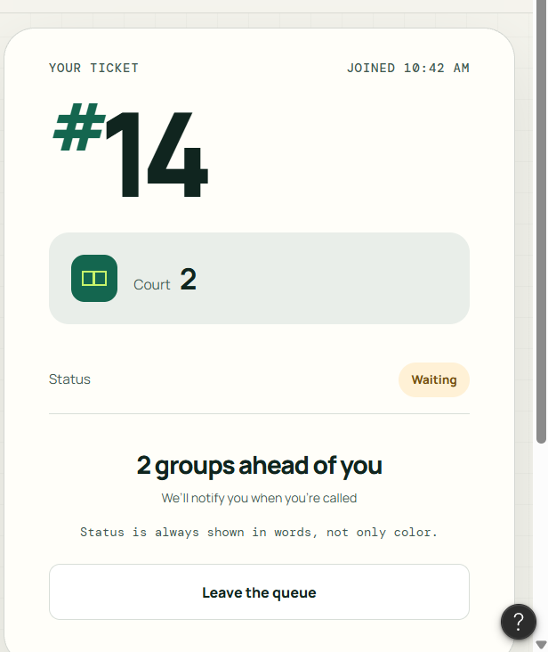
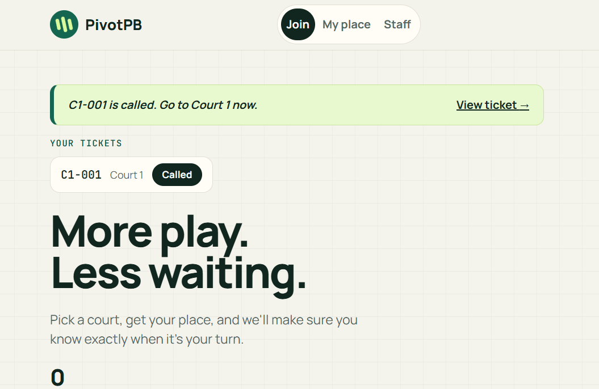

# Usability test

## Participant

* Who they are: Dothy
* Which persona they match: Jerich (player) and Lara (organizer) --> Tested both functions
* Is this a pickleball player or organizer: No, but frequently joins her friends in going to pickleball tournaments.
* Date, device and place of the test: 3 pm, October 23, 2026, Core Group Office, IPDM
* How I ran it: In person
* Permission to record asked: Yes

## Tasks

I read each task aloud, did not help, and asked them to think aloud.

| Task | Finished | About how long | Where they hesitated, what they said, what surprised me |
| --- | --- | --- | --- |
| 1. "You just arrived. Get in line for Court 1." | Yes | around 5-10 seconds | I was surprised because she did not hesitate when operating the web app; it was as if she was already familiar with the web app.|
| 2. "How many groups are ahead of you? What is your ticket number?" | Yes (she found it and read it aloud) | around 1-3 seconds | The tester did not raise any concerns |
| 3. "Pretend you are the organizer. Call the next group and mark them as served." | Yes | around 5-10 seconds | She did not raise any concerns |

## Did my design rules hold up?

Mark each one as held, partly, or did not hold, with a short reason.

**Jerich**

1. Ticket number, court and position are the biggest things on My place: Held. The tester found their ticket number and how many groups were ahead quickly and without complaint.
2. Large text and strong contrast, status shown in words: No problem raised. I did not test outdoors in bright light.
3. Tickets are numbered in the order people join and a player cannot change their place: Held. She can not change anything in her ticket after filling it up.
4. The page updates by itself and being called is unmissable: Held. The tester noticed the "Your tickets" strip, and we tested them being called while on another page (there was a notification).

**Lara**

1. Each court is clearly separated and can be filtered: Held. The tester completed the organizer task and raised no problem.
2. Call next is easy to reach and every action takes one tap: Held. The tester called the next group and marked it served within seconds.
3. Each row clearly shows the ticket and its own buttons: Held. No confusion was raised.
4. A no show can be marked quickly so the line keeps moving: Not tested in this session.

## Most serious problem I found

**Where it came from:** My own testing while preparing for the user test. I tried to behave like Jerich, who joins one court and then decides to try another while the first line is still moving. My tester (Dothy) did not find any problem, which is why this one came from my own run through. When I asked them to join a second court, they noticed the "Your tickets" strip, which suggests the fix is easy to find.

**Description:** When I joined a second court while my first ticket was still waiting, the app only remembered my newest ticket. My place switched to the new ticket and gave me no sign at all when the first ticket was called. I could miss my turn on Court 1 while looking at my place on Court 2.

**Why I chose it over the others:** It breaks visibility of system status at the most important moment of a visit, which is being called. It also breaks Jerich's fourth design rule, that being called must be unmissable. Staff then mark the missed group as a no show, which is unfair to the player.

## The improvement I made

**Problem:** A player who joined more than one court lost all updates about their earlier tickets, so they could miss being called.

**Fix:**

1. The app now remembers every ticket a browser creates, instead of only the newest one.
2. A "Your tickets" strip on every page lists each active ticket with its court and a live status pill, so a player can switch between them in one tap.
3. When any ticket is called, a dark alert appears at the top of whatever page the player is on, for example "C1-001 is called. Go to Court 1 now", and it links straight to that ticket.
4. A player can hold only one active ticket per court, which also stops a double tap from creating two tickets.
5. Only the browser that joined can leave a ticket, so a shared link cannot remove someone from the line.
6. My place, the join page and the staff dashboard refresh every 5 seconds without a reload, so counts and statuses stay current.

While making this change I also removed the sample tickets so the queue starts empty like a real app, replaced the automatic reload on the staff court filter with a visible Show button so keyboard users can reach every court, and moved focus back to the court box after a court is picked.

**Before:**

On the Court 2 ticket page, nothing shows that my Court 1 ticket was called.

**After:**

The same Court 2 page now shows a dark alert that C1-001 is called, with a link to it.

**What I would check next time:** 
1. The tester finished everything in under a minute and wanted no changes, but one tester is a small sample. I would test with more players and with an organizer who runs several courts at once.
2. I would check whether players want two active tickets at once, since someone could hold places on several courts.