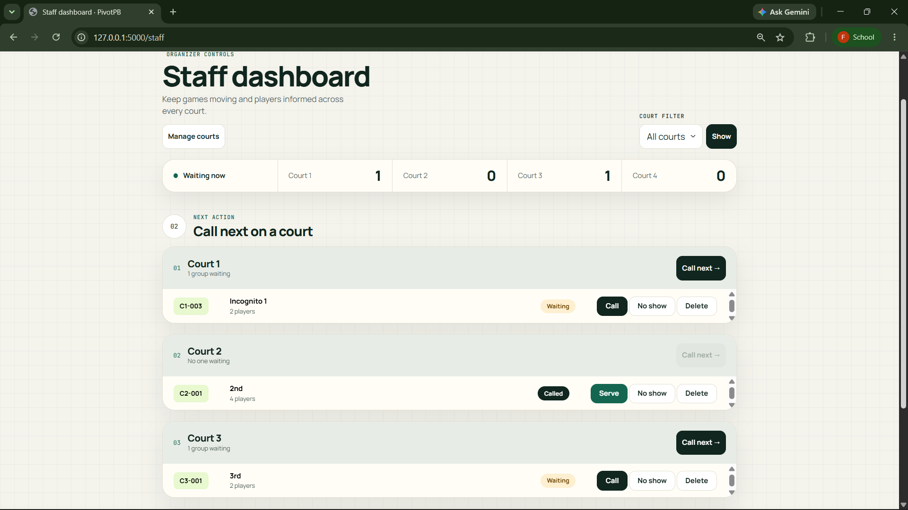
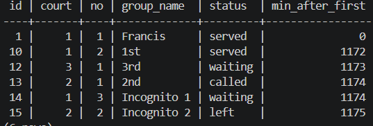
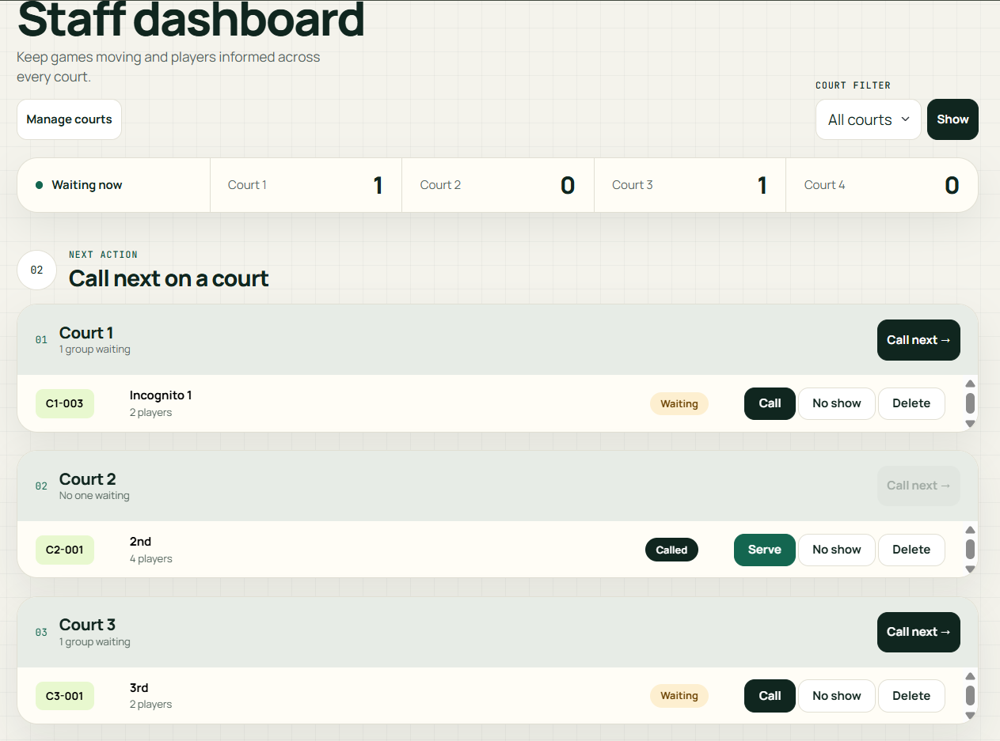
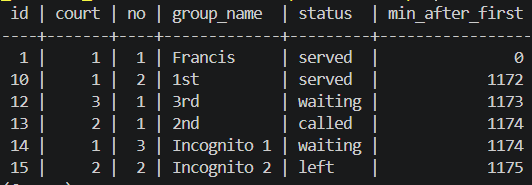
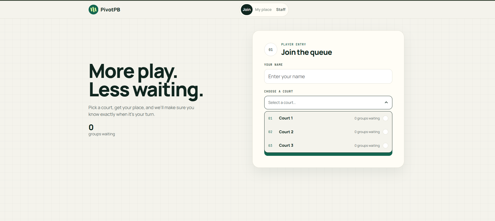

# Persistence proof

This checks NFR-01: no ticket is lost when Flask, Docker or the database restarts.

## Restart test

1. I created tickets on three courts using a normal window and an incognito window, so each browser counted as its own visitor. Then I called one group and left it called, served two groups, and let one player leave. That gave six tickets in four statuses: served, called, waiting and left.
2. **Before the restart.** The staff dashboard lists the active tickets (12, 13 and 14), and this query lists all six. To keep my clock time private, I show how many minutes after the first ticket each one joined instead of the time of day. The numbers still prove the stored times are unchanged.

   `docker compose exec db psql -U pivotpb -P pager=off -c "SELECT id, court_id AS court, number AS no, group_name, status, round(extract(epoch FROM created_at - (SELECT min(created_at) FROM tickets)) / 60) AS min_after_first FROM tickets ORDER BY id;"`

   
   

3. I stopped Flask with Ctrl+C, ran `docker compose down`, and ran `docker compose ps`, which listed nothing running.
4. I ran `docker compose up -d`, waited until `docker compose ps` said **healthy**, and started Flask again with `flask --app app run --debug`.
5. **After the restart.** The same dashboard and the same query.

   
   

**Result:** all six tickets came back with the same ids, groups, statuses and join times (0, 1172, 1173, 1174, 1174 and 1175 minutes after the first ticket). The data lives in the named volume `pgdata`, and `docker compose down` removes only the container.

## Rebuild from scratch

I ran this to prove my migrations can rebuild the whole database on a new computer. It deletes all data, so I did it after the restart test:

```
docker compose down -v
docker compose up -d
flask --app app db upgrade
flask --app app seed
```

**Result:** `docker compose down -v` removed the container, the volume and the network. After `up -d`, `flask db upgrade` ran both migrations in order (`initial tables`, then `add courts.active`), and `flask seed` printed "Courts are ready." Flask started, and the join page loaded with the seeded courts and no old tickets.



## NFR-01

Passed. A full stop of Flask and Docker lost no ticket, and the database also rebuilt from my migrations alone.