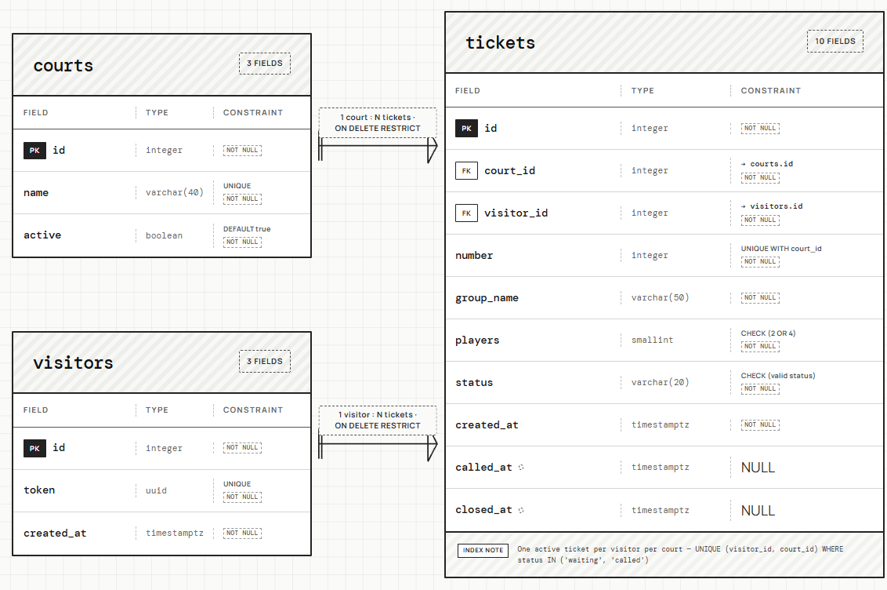
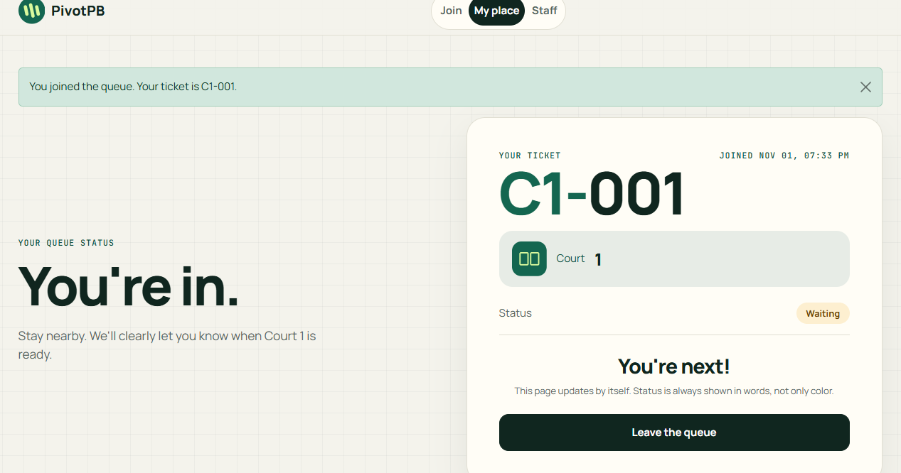
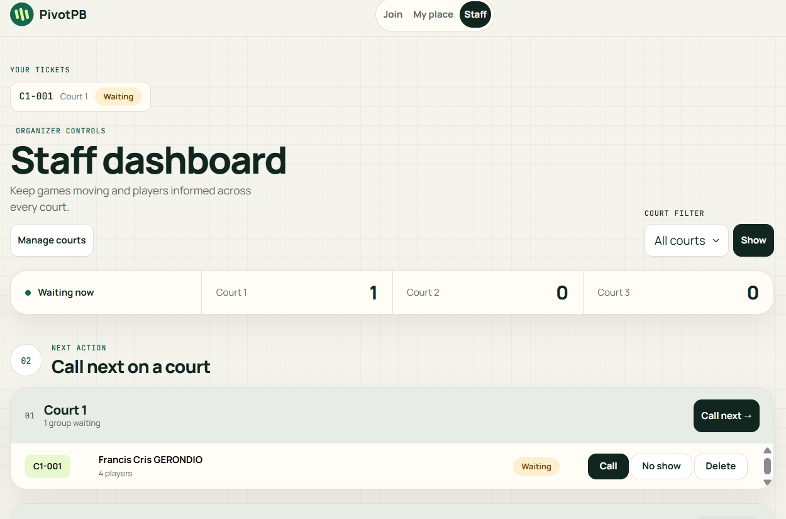
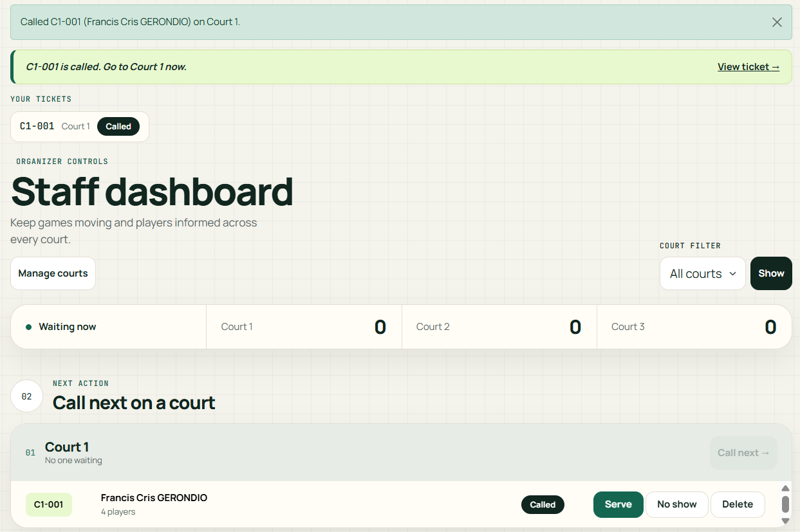
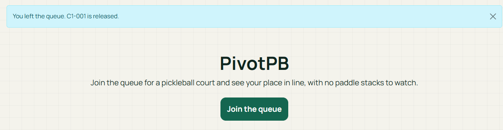
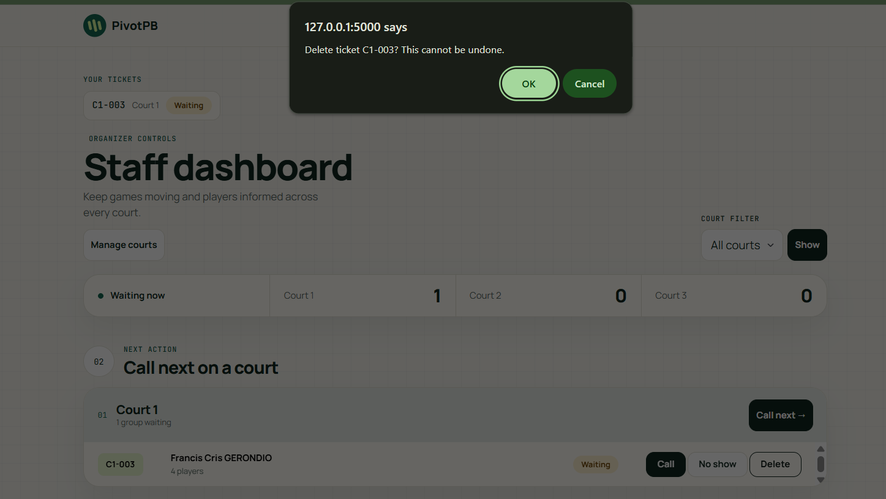
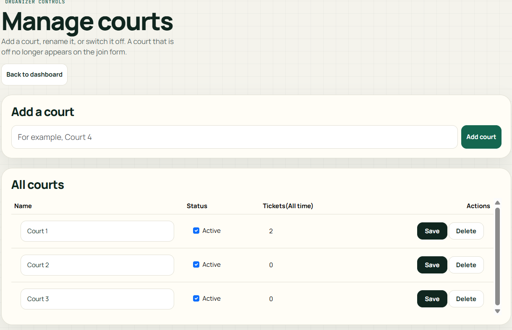
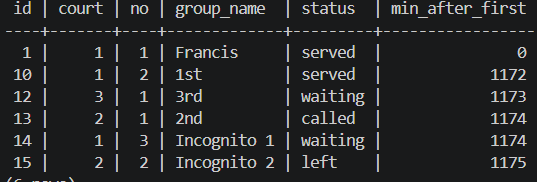
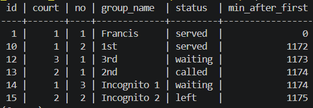

# Week 4 report: PivotPB

## 1. Title details

- **App:** PivotPB
- **Setting:** Open play pickleball at three courts, weekday evenings
- **Name:** Francis Cris Gerondio
- **Student ID:** 2024-0861
- **Section:** CS3B
- **Date:** October 31, 2026
- **Pull request:** 
- **Database:** PostgreSQL 17 in Docker (no local PostgreSQL fallback was used)

## 2. Requirements

I wrote 14 functional requirements (4 marked ★: FR-06, FR-07, FR-08, FR-13) and 6 non functional requirements, all with an ID and a priority. Every functional requirement says whether it stores data. The full list is in [docs/requirements.md](../requirements.md).

**MVP:** FR-01 to FR-05, FR-07, FR-08, FR-10, FR-11, NFR-01, NFR-02, NFR-04 and NFR-05. It is the smallest version that replaces the paddle stack, because players can join and see a trustworthy place in line, and the organizer can move the line forward on a database that never forgets a ticket.

**Check with a real person:** [FILL IN: their role, what they said, and what you changed in the list. This has to come from a real conversation.]

## 3. ERD



- One court has many tickets. Each ticket belongs to exactly one court.
- One visitor has many tickets. Each ticket belongs to exactly one visitor.

Full design: [schema.md](schema.md).

## 4. Schema

Output of `\d` for each table, from [schema-output.txt](schema-output.txt):

The full output is saved in [schema-output.txt](schema-output.txt). The key parts, from the first migration:

```
Table "public.courts"
 Column |         Type          | Nullable |              Default
--------+-----------------------+----------+------------------------------------
 id     | integer               | not null | nextval('courts_id_seq'::regclass)
 name   | character varying(40) | not null |
Indexes:
    "courts_pkey" PRIMARY KEY, btree (id)
    "courts_name_key" UNIQUE CONSTRAINT, btree (name)
Check constraints:
    "ck_courts_name_not_blank" CHECK (length(TRIM(BOTH FROM name)) > 0)
Referenced by:
    TABLE "tickets" CONSTRAINT "tickets_court_id_fkey" FOREIGN KEY (court_id) REFERENCES courts(id) ON DELETE RESTRICT

Table "public.visitors"
 Column |  Type   | Nullable |               Default
--------+---------+----------+--------------------------------------
 id     | integer | not null | nextval('visitors_id_seq'::regclass)
 token  | uuid    | not null | gen_random_uuid()
Indexes:
    "visitors_pkey" PRIMARY KEY, btree (id)
    "visitors_token_key" UNIQUE CONSTRAINT, btree (token)
Referenced by:
    TABLE "tickets" CONSTRAINT "tickets_visitor_id_fkey" FOREIGN KEY (visitor_id) REFERENCES visitors(id) ON DELETE RESTRICT

Table "public.tickets"
   Column   |           Type           | Nullable |               Default
------------+--------------------------+----------+-------------------------------------
 id         | integer                  | not null | nextval('tickets_id_seq'::regclass)
 court_id   | integer                  | not null |
 visitor_id | integer                  | not null |
 number     | integer                  | not null |
 group_name | character varying(50)    | not null |
 players    | smallint                 | not null |
 status     | character varying(20)    | not null | 'waiting'::character varying
 created_at | timestamp with time zone | not null | now()
 called_at  | timestamp with time zone |          |
 closed_at  | timestamp with time zone |          |
Indexes:
    "uq_tickets_court_number" UNIQUE CONSTRAINT, btree (court_id, number)
    "uq_tickets_one_active_per_court" UNIQUE, btree (visitor_id, court_id) WHERE status::text = ANY (ARRAY['waiting', 'called'])
Check constraints:
    "ck_tickets_group_name_not_blank" CHECK (length(TRIM(BOTH FROM group_name)) > 0)
    "ck_tickets_number_positive" CHECK (number > 0)
    "ck_tickets_players" CHECK (players = ANY (ARRAY[2, 4]))
    "ck_tickets_status" CHECK (status IN ('waiting', 'called', 'served', 'no-show', 'left'))
Foreign-key constraints:
    "tickets_court_id_fkey" FOREIGN KEY (court_id) REFERENCES courts(id) ON DELETE RESTRICT
    "tickets_visitor_id_fkey" FOREIGN KEY (visitor_id) REFERENCES visitors(id) ON DELETE RESTRICT
```

The second migration then added `active boolean not null default true` to `courts`.

## 5. Design decisions

1. **A `visitors` table with a cookie token, not a `users` table.** PivotPB has no accounts and the join form only asks for a group name, so there is no email to identify a person. A random token in the cookie links a browser to its tickets. This meets FR-09 and keeps another player from taking someone's place (NFR-02).
2. **Ticket numbers are unique per court, enforced by the database.** `UNIQUE (court_id, number)` means two groups tapping Join together cannot share a number, even if Flask has a bug. If the insert collides, Flask rolls back and retries with the next number. This meets FR-08 and NFR-02.
3. **Position in line is computed, not stored.** I store `number` and `created_at`, and count the waiting tickets with a lower number on the same court. A stored position would need rewriting for many rows whenever someone joined or left. This meets FR-02.

## 6. Self-review

From [schema-review.md](schema-review.md): blank names got past NOT NULL, so I added `CHECK (length(trim(...)) > 0)` on `tickets.group_name` and `courts.name`. `visitors.created_at` was needed by no requirement, so I removed it. I left `closed_at` without a CHECK tying it to `status`, and set it in the routes instead. I will revisit that in Week 7.

## 7. Migrations

- `migrations/versions/0fd57e7987d7_initial_tables.py`: creates `courts`, `visitors` and `tickets` with their keys, constraints, checks and the partial unique index.
- `migrations/versions/0482b48aeecd_add_courts_active.py`: adds `courts.active` with a server default of true, so the existing rows stay valid. Downgrade and upgrade both worked.

## 8. CRUD

| Operation | Route | Requirement | Screenshot |
| --- | --- | --- | --- |
| Create | `POST /join` | FR-01, FR-07, FR-08 |  |
| Read | `GET /queue/<id>` and `GET /staff` | FR-02, FR-04, FR-06 |  |
| Update | `POST /staff/tickets/<id>/<action>` and `POST /staff/courts/<id>/call-next` | FR-05 |  |
| Soft delete | `POST /queue/<id>/leave` | FR-03 |  |
| Hard delete | `POST /staff/tickets/<id>/delete` | FR-12 |  |
| Manage courts | `/staff/services` | FR-11 |  |

Every route that changes data is a POST. Leaving sets the status to `left` and keeps the row, so FR-13 can count it later. Deleting a mistaken ticket removes the row after a confirmation.

## 9. Validation

Summary of [validation.md](validation.md). Bad requests sent with curl returned 400 and saved nothing (2 tickets before and after). In psql, every bad insert failed with the expected constraint: foreign key, check, not null, unique, the partial unique index, and ON DELETE RESTRICT. No SQL is built in f-strings.

The most useful error was `ck_tickets_group_name_not_blank`. It showed that NOT NULL does not stop an empty or space only name.

## 10. Persistence

Details and screenshots: [persistence.md](persistence.md).




After `docker compose down` and `up -d`, all six tickets came back with the same statuses and the same times. The rebuild from scratch (`docker compose down -v`, `up -d`, `flask db upgrade`, `flask seed`) ran both migrations and seeded the three courts, and the app opened and accepted a new ticket. **NFR-01 passed.**

## 11. Reflection

- **Hardest this week:** Getting the tools set up and then designing the data. I first installed the packages into my global Python instead of a virtual environment and had to redo it with a `.venv`. The hardest design choice was replacing the Week 3 idea of tickets owned by a browser session with a `visitors` table, because I had no email or account to identify a player.
- **Requirement hardest to write testably:** NFR-02, that two people can never get the same ticket even when they join at the same moment. A normal click test cannot prove it, so I tested the rule where it actually lives, with the `uq_tickets_court_number` unique constraint, and showed it fails in psql.
- **A report my staff persona would want:** how many groups left before being served, per court, per day. I will write that query in Week 5.

## 12. Declaration

I used Claude (Anthropic) in this activity. It helped me plan the schema and ERD, write and debug `models.py`, `app.py`, the templates, and draft the documentation of this report. I ran every command and test myself, checked the results in PostgreSQL, and can explain each table, constraint and route.