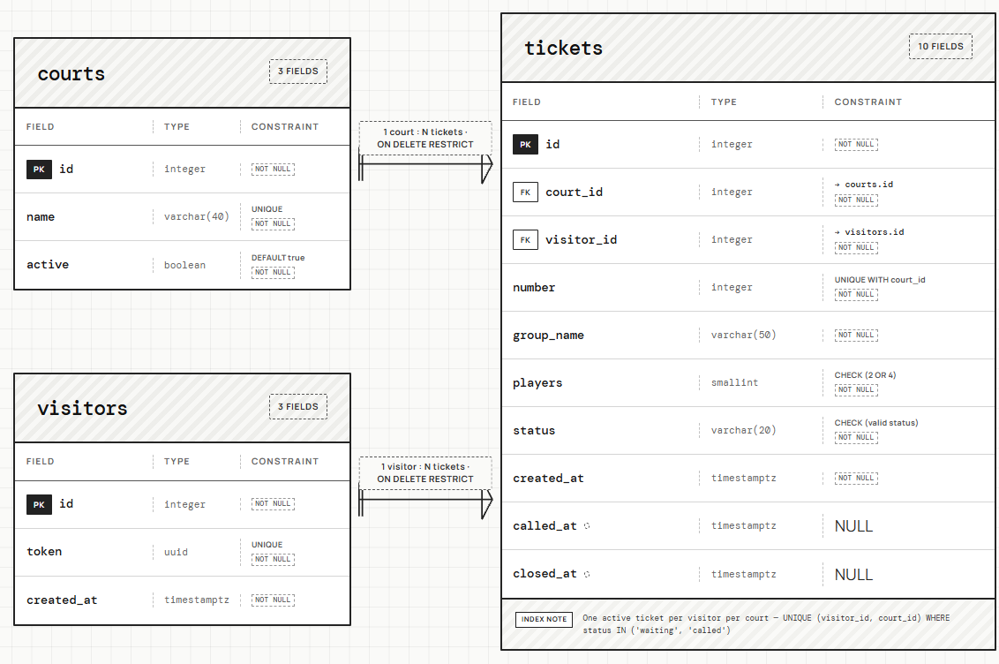

# PivotPB schema (Week 4)

## 2a. Nouns in the data requirements

| Req ID | Requirement | Nouns | Table or column? |
| --- | --- | --- | --- |
| FR-01 | A **player** can join the line for a **court** by entering their **name**. | player, line, court, name | visitors, *(not a table)*, courts, tickets.group_name |
| FR-02 | A player can see their **ticket code**, **status** and how many groups are **ahead**. | ticket code, status, ahead | courts.id + tickets.number, tickets.status, *(computed)* |
| FR-03 | A player can **leave** the line. | leave | tickets.status = left, tickets.closed_at |
| FR-04 | An organizer can see each court's **waiting list** in the **order** groups joined. | waiting list, order | *(query)*, tickets.number and tickets.created_at |
| FR-05 | An organizer can **call**, **serve** or **no show** a group. | call, serve, no show | tickets.status, tickets.called_at, tickets.closed_at |
| FR-06 | An organizer can see how many groups are **waiting** on each court. | count | *(computed)* |
| FR-07 | A player chooses a **group size** of 2 or 4. | group size | tickets.players |
| FR-08 | Every court has its own **ticket numbers**. | ticket number | tickets.number, unique per court |
| FR-09 | A player on several courts sees all **their active tickets**. | player's tickets | visitors.token, tickets.visitor_id |
| FR-11 | An organizer can **add**, **rename** and **switch off** a court. | court name, active | courts.name, courts.active |
| FR-12 | An organizer can **delete** a mistaken ticket. | ticket | tickets row |
| FR-13 | An organizer sees how many groups **left** before being served, per court, per day. | left, day | tickets.status, tickets.closed_at, tickets.court_id |

Two decisions from this table:

- **The line is not a table.** It is all tickets with status `waiting` on one court, ordered by `number`.
- **Position is computed.** I store when a ticket joined and its number. "Groups ahead" is counted when needed, so nothing has to be rewritten when someone leaves.

## 2b. Tables

PivotPB has no accounts and no email, so I did not copy ClinicQ's `users` table. A player is a browser that holds a secret token in a cookie.

| Table | Columns |
| --- | --- |
| `courts` | id, name, active |
| `visitors` | id, token |
| `tickets` | id, court_id, visitor_id, number, group_name, players, status, created_at, called_at, closed_at |

Where each Week 3 field went:

- The group's name is about this one visit, so it is `tickets.group_name`, not a person row. Two visits can use different names.
- Group size (2 or 4) can change every visit, so it is `tickets.players`.
- Ownership of a ticket ("no one else can take their place") is about the browser, so it is `visitors.token` with `tickets.visitor_id`. This replaces the `BOOT_ID` workaround and the list of ticket ids kept in the Flask session.
- The court number is about the court, so it lives in `courts`. The ticket number is about this ticket within one court.

## 2c. Types and constraints

| Table | Column | PostgreSQL type | Constraint | Why |
| --- | --- | --- | --- | --- |
| courts | id | integer, generated | PRIMARY KEY | Generated by the database, never reused (FR-11) |
| courts | name | varchar(40) | NOT NULL, UNIQUE, CHECK (length(trim(name)) > 0) | Two courts cannot share a name, and the name cannot be blank (FR-11) |
| courts | active | boolean | NOT NULL DEFAULT true | Switch a court off without losing its history (FR-11) |
| visitors | id | integer, generated | PRIMARY KEY | Stable key for tickets |
| visitors | token | uuid | NOT NULL, UNIQUE, DEFAULT gen_random_uuid() | Unguessable cookie value, so nobody can claim another player's tickets (FR-09) |
| tickets | id | integer, generated | PRIMARY KEY | Used in URLs, unique forever |
| tickets | court_id | integer | NOT NULL, FOREIGN KEY to courts(id) | No ticket for a missing court (FR-01) |
| tickets | visitor_id | integer | NOT NULL, FOREIGN KEY to visitors(id) | Every ticket has an owner (FR-09) |
| tickets | number | integer | NOT NULL, CHECK (number > 0), UNIQUE (court_id, number) | Two groups never share a number on a court (FR-08, NFR-02) |
| tickets | group_name | varchar(50) | NOT NULL, CHECK (length(trim(group_name)) > 0) | Matches the 50 character limit in the form, and blank names are rejected (FR-01) |
| tickets | players | smallint | NOT NULL, CHECK (players IN (2, 4)) | Only groups of 2 or 4 (FR-07) |
| tickets | status | varchar(20) | NOT NULL DEFAULT 'waiting', CHECK (status IN ('waiting', 'called', 'served', 'no-show', 'left')) | Only the five statuses the app knows (FR-02, FR-05) |
| tickets | created_at | timestamptz | NOT NULL DEFAULT now() | Order and time joined (FR-04) |
| tickets | called_at | timestamptz | nullable | Empty until the group is called (FR-05) |
| tickets | closed_at | timestamptz | nullable | Set when served, no show or left, for reports (FR-13) |

One more rule, written as a partial unique index: **UNIQUE (visitor_id, court_id) WHERE status IN ('waiting', 'called')**. A browser can hold only one active ticket on a court, which stops double taps at the database level (FR-09).

Constraint types used: PRIMARY KEY, FOREIGN KEY, NOT NULL, UNIQUE, CHECK, and `timestamptz`.

## 2d. ERD

Relationships read aloud:

- One court has many tickets. Each ticket belongs to exactly one court.
- One visitor has many tickets. Each ticket belongs to exactly one visitor.

The foreign key always sits on the "many" side, so both keys are in `tickets`.

Delete rules:

| Foreign key | Rule | Reason |
| --- | --- | --- |
| tickets.court_id to courts | RESTRICT | Old tickets are needed for reports (FR-13), so a court with tickets cannot be deleted. Organizers switch it off instead. |
| tickets.visitor_id to visitors | RESTRICT | Deleting a browser must never erase ticket history. |

## 2e. Normalization

1. **One value per cell (1NF):** yes. No column holds a list. A group's name is one text value and `players` is one number.
2. **Depends on the whole key (2NF):** there are no join tables, and every table has a single column primary key, so every column depends on the whole key.
3. **No hidden copies (3NF):** a court's name is stored once in `courts` and reached through `court_id`. Nothing is copied into `tickets`. A visitor's token is stored once in `visitors`.